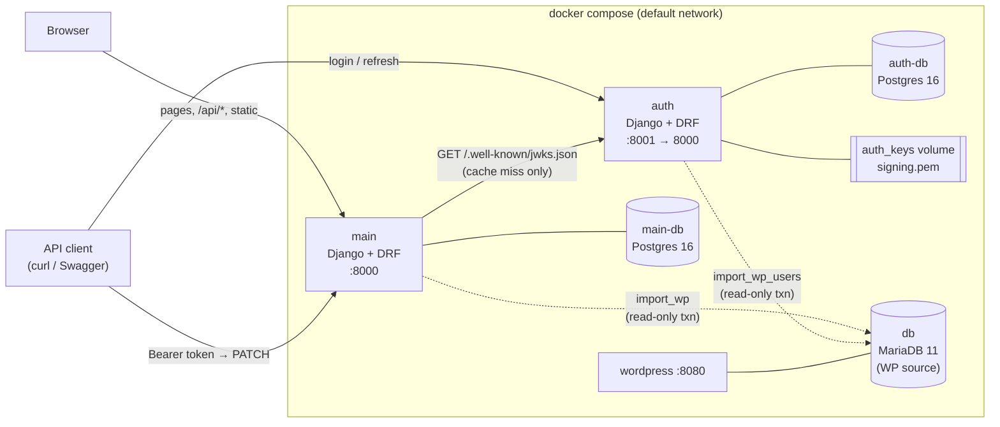
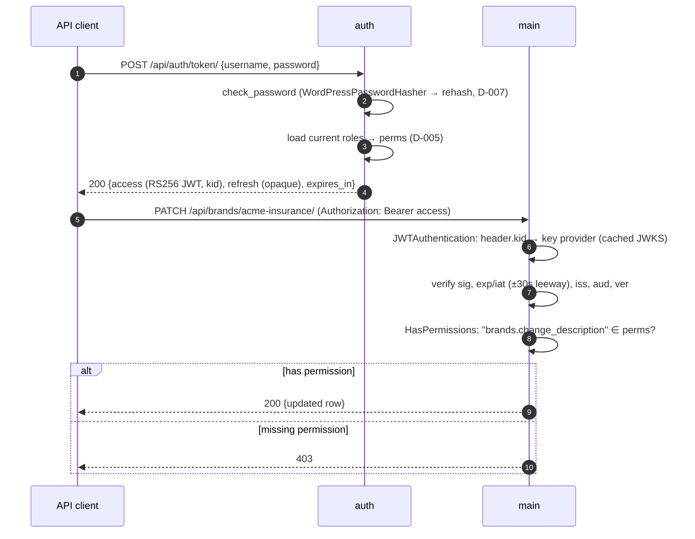
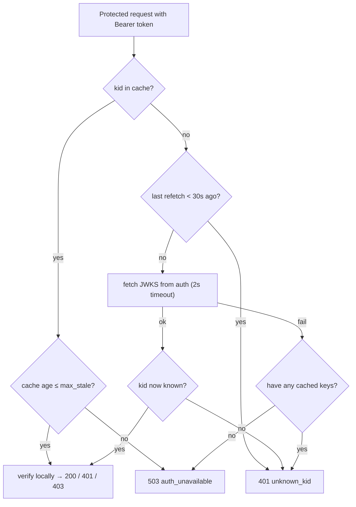

# Design: System Architecture (spec 0)

Implements #[[file:.kiro/specs/system-architecture/requirements.md]]. Decisions are cited as D-NNN (`.kiro/steering/decisions.md`). Anything marked **(design choice)** is new in this document and is listed in §13 for review.

## 1. Overview



- **Solid arrows** are runtime traffic. **Dotted arrows** are operator-run imports.
- The browser only ever talks to `main` (Req 9.2).
- `main` calls `auth` for exactly one thing: fetching the JWKS when its cache is empty, stale or missing a `kid`. It never calls `auth` per request (Req 4.7).

## 2. Repository and package layout

As in `structure.md`. The parts this spec fixes:

```
docker-compose.yml          # base, production-like: + main, auth, main-db, auth-db (WP services unchanged)
docker-compose.override.yml # dev overrides, auto-loaded: runserver, DEBUG=1, bind mounts (§3.1, D-033)
.dockerignore               # excludes wp-content/, db/, node_modules/, .git, .agents/
Makefile                    # new targets (§9)
.env.example                # + variables in §8
packages/auth_common/       # §5
services/main/Dockerfile    # multi-stage: node → python (build context = repo root)
services/main/entrypoint.sh
services/auth/Dockerfile    # python only (build context = repo root)
services/auth/entrypoint.sh
```

**Build context is the repo root** for both images, so each Dockerfile can `COPY packages/wheelhouse` (released wheels only, never the library source). `.dockerignore` keeps the WP tree and dump out of the context.

### 2.1 How `auth_common` is pinned and installed (Req 2.9, 8.6, D-003)

**Revised during task 3 (D-003 amendment 2).** The first version of this section used a source-path dependency with an `==` pin. Testing showed uv ignores the specifier for path sources, so the pin was never enforced and both services always ran the current library source.

**Release flow:** `make release-auth-common` → `scripts/release-auth-common.sh`:
1. Refuse if `packages/wheelhouse/auth_common-<version>-py3-none-any.whl` already exists (immutable releases), or if `CHANGELOG.md` lacks a `## <version>` entry.
2. Run the library's quality gate (`uv sync --locked`, pytest, mypy, ruff, format).
3. `uv build --wheel --out-dir packages/wheelhouse --no-create-gitignore`. The wheels are committed.

**Pin, in each service's `pyproject.toml`:**

```toml
[project]
dependencies = [
  "auth-common[drf]",   # version pinned by the wheel path below
  # ...
]

[tool.uv.sources]
auth-common = { path = "../../packages/wheelhouse/auth_common-0.0.1-py3-none-any.whl" }
```

- **The wheel filename is the pin.** No `==` specifier: uv would ignore it for a path source, and a second source of truth could disagree.
- **Integrity and portability:** `uv.lock` stores the wheel by **relative** path plus its **sha256**, so `uv sync --locked` works on any machine and in Docker, and fails if the wheel's bytes change (verified).
- **Independent upgrades (D-016, Req 8.6):** old wheels stay in the wheelhouse, so one service can move to `0.2.0` while the other stays on `0.1.0`.
- **No dependency confusion:** a path source is never looked up on PyPI.
- **Rejected alternative:** an explicit flat `[[tool.uv.index]]` honors `==` pins, but uv writes the index location into `uv.lock` as an **absolute** path, which breaks `--locked` elsewhere (verified).
- Images install with `uv sync --frozen --no-dev` after copying `packages/wheelhouse/` (not the library source) into the build.
- With more time (README): publish the same wheels to a private index and point `[tool.uv.sources]` at it. The release process stays the same.

## 3. Compose topology (Req 2)

| Service | Image / build | Host port | Depends on (healthy) | Volumes | Healthcheck |
|---|---|---|---|---|---|
| `db`, `wordpress`, `phpmyadmin`, `wpcli` | unchanged | 8080, 8081 | unchanged | unchanged | unchanged |
| `main-db` | `postgres:16` | — | — | `main_db_data` | `pg_isready` |
| `auth-db` | `postgres:16` | — | — | `auth_db_data` | `pg_isready` |
| `auth` | `services/auth/Dockerfile` | `8001:8000` | `auth-db` | `auth_keys:/run/keys` | `GET /healthz/ready` |
| `main` | `services/main/Dockerfile` | `8000:8000` | `main-db` (**not** `auth`, Req 2.7) | — | `GET /healthz/ready` |

- All services share Compose's default network, so `main` resolves `auth` and `db` by name. The WP services need no edit.
- `main` and `auth` both reach `db:3306` (WP MariaDB) for imports only.
- `main` has **no** `depends_on: auth`. Starting `main` while `auth` is down is a supported state (Req 6.1).
### 3.1 Two modes: base file + override (D-033)

Compose automatically merges `docker-compose.override.yml` on top of `docker-compose.yml`, so **plain `docker compose up` / `make up` is dev mode**. Production-like mode runs the base file alone.

| | **Base**, `docker-compose.yml` (production-like) | **Override**, `docker-compose.override.yml` (dev, auto-loaded) |
|---|---|---|
| Server `command:` | `gunicorn config.wsgi --bind 0.0.0.0:8000 --workers 2` | `python manage.py runserver 0.0.0.0:8000` |
| `DJANGO_DEBUG` | `"0"` | `"1"` |
| Source code | baked into the image | bind mount `./services/<svc>:/app` (live reload) |
| `auth_common` | the service's pinned wheel, installed into the image | **the same pinned wheel**, not mounted. Services always run a released version, so dev can't drift from what's pinned (D-003 amendment 2) |
| Debugging | — | `stdin_open: true`, `tty: true`, so `breakpoint()` works after `docker attach <container>` |
| Signing key | must already exist in `auth_keys` (refuses to start otherwise, D-031) | auto-generated on first start (D-031) |
| Static files | WhiteNoise from the image's `collectstatic` output | WhiteNoise via `whitenoise.runserver_nostatic`, so dev serves static the same way as prod |
| `/api/docs/` | off | on |
| How to run | `make up-prod` | `make up` |

- The WP services, databases, volumes, ports, healthchecks and the entrypoint are defined **only in the base file**. The override changes only `command`, `environment.DJANGO_DEBUG`, `volumes`, `stdin_open` and `tty` for `main` and `auth`, so the two modes can't drift structurally.
- **Built frontend assets live outside the bind-mounted path** (`/opt/frontend-dist` in the image, added to `STATICFILES_DIRS`), so the dev source mount can't hide them. In dev, `VITE_DEV_SERVER` can point templates at Vite instead (§7).
- **Known dev/prod difference (documented trade-off):** runserver is single-process and threaded; gunicorn is multi-process. The multi-worker race D-031 guards against is never exercised in dev. It's covered by running the entrypoint before the server in both modes, and by `make up-prod` in the e2e checks (§11).

### 3.2 Entrypoint: shared by both modes (Req 2.6, 5.3, D-031, D-032.7)

The entrypoint does setup and then `exec`s whatever server command the active compose file provides:

```sh
# services/auth/entrypoint.sh
set -eu
python manage.py migrate --noinput
python manage.py ensure_signing_key   # no-op if the file exists; refuses when DEBUG is off
exec "$@"                              # gunicorn (base) or runserver (override)

# services/main/entrypoint.sh
set -eu
python manage.py migrate --noinput
exec "$@"
```

- `ensure_signing_key` runs once, before any server process or worker exists. That's why it can't race in either mode (D-031).
- Static files are collected at **image build time** in `main` (§7), not in the entrypoint.

### 3.3 Running production-like mode locally

`make up-prod` runs `docker compose -f docker-compose.yml up -d --build`, with three preparations so the base file's `DEBUG=0` safeguards pass:

1. **Secret key:** `DJANGO_SECRET_KEY` is set to a random value for that invocation (`openssl rand -hex 32`). The dev default would be refused (Req 10.4).
2. **Signing key:** `make prod-key` provisions `auth_keys` once, standing in for mounting a real secret. It runs `ensure_signing_key` in a one-off container with `DJANGO_DEBUG=1` explicitly for that single command. `make up-prod` depends on it. Without it, the auth service refuses to start, which is the behavior Req 5.4 requires.
3. **Same volumes as dev:** data and the key are shared, so switching modes keeps imported content.

## 4. Token flows

### 4.1 Login and a protected write (Req 4.1, 4.5, 4.7, 4.9)



No network call to `auth` happens in steps 5–8 while the JWKS cache is fresh (Req 4.7).

### 4.2 Refresh and role change (Req 4.2, 7.1, 7.2)

```mermaid
sequenceDiagram
  participant C as API client
  participant A as auth
  C->>A: POST /api/auth/token/refresh/ {refresh}
  A->>A: look up refresh-token hash; reject if unknown / revoked / expired
  A->>A: rotate: revoke old refresh, issue new one
  A->>A: re-read CURRENT roles → perms
  A-->>C: 200 {access (new perms), refresh (new)}
```

- **Role change latency** is at most one access-token lifetime, because a demoted user's existing access token keeps its old `perms` until `exp` (Req 7.1).
- **Logout** (`POST /api/auth/logout/ {refresh}`) revokes the refresh token. The current access token survives until `exp` (Req 7.2).
- Refresh tokens are stored **hashed** (SHA-256 of a 256-bit random value), never in plaintext. **(design choice)**
- Exact endpoint paths, TTLs, and whether refresh rotation reuse-detection is in scope belong to spec 2. Proposed starting values: access **10 min**, refresh **7 days**.

### 4.3 Auth service down / unknown `kid` (Req 6)



- **Background freshness:** when the cache is older than `fresh_ttl` (5 min), the next request triggers a refetch. If that fetch fails, the cached keys are **kept** and still used until `max_stale` (1 h) (Req 6.2, 6.6). This is one lock-protected fetch per process, never one per request.
- **Rate limit:** at most one unknown-`kid` refetch per 30 s per process, so a flood of forged `kid`s can't amplify into a flood of requests to `auth` (Req 6.4).
- **`503` vs `401`:** `401` means "this token is not acceptable". `503` means "we can't judge any token right now" (D-032.3).
- Public endpoints never reach this path (§6.1), so an auth outage can't affect them (Req 6.1).

Values (`fresh_ttl=300s`, `max_stale=3600s`, `refetch_min_interval=30s`, `timeout=2s`, `leeway=30s`) are settings with these defaults. Spec 2 may tune them. **(design choice)**

## 5. `auth_common` design (Req 8, D-006)

```
auth_common/
  __init__.py      # __version__, re-exports of the public API below
  py.typed
  claims.py        # Claims (frozen dataclass), Permission/Role constants, CLAIMS_VERSION
  identity.py      # WP_USER_NAMESPACE, wp_user_uuid()
  keys.py          # KeyProvider Protocol, StaticKeyProvider, KeysUnavailable
  verify.py        # TokenVerifier, InvalidToken (+ reason enum)
  drf.py           # JWTAuthentication, TokenUser, HasPermissions, AuthUnavailable (503)
```

### 5.1 Public API

| Symbol | Purpose | Used by main | Used by auth |
|---|---|---|---|
| `Claims` | parsed, validated claims (`sub: UUID`, `roles`, `perms: frozenset[str]`, `exp`, `jti`, `ver`, …) | ✓ (verify) | ✓ (build tokens, verify `/me`) |
| `Perm.BRANDS_CHANGE_DESCRIPTION`, `Role.READER/EDITOR` | the one shared vocabulary | ✓ | ✓ (role→perm table) |
| `CLAIMS_VERSION` | the `ver` value the library emits/accepts (D-016) | ✓ | ✓ |
| `wp_user_uuid()` | D-021 | ✓ (`import_wp`) | ✓ (`import_wp_users`) |
| `KeyProvider` (Protocol): `get(kid) -> PublicKey` | the seam between verification and key sourcing | implements `JWKSKeyProvider` | uses `StaticKeyProvider` |
| `StaticKeyProvider` | wraps an in-memory public key | (tests) | ✓ |
| `TokenVerifier(provider, issuer, audience, leeway)` | `.verify(token) -> Claims`. Raises `InvalidToken(reason)` or `KeysUnavailable` | ✓ | ✓ |
| `drf.JWTAuthentication` | Bearer → `(TokenUser, Claims)`. `authenticate_header()` returns `Bearer realm="api"` so failures are 401 (D-001) | ✓ | ✓ (`/me`) |
| `drf.TokenUser` | non-model user: `id`/`pk` = `sub`, `is_authenticated=True`, `perms`, `has_perm()` | ✓ | ✓ |
| `drf.HasPermissions` | checks `view.required_permissions ⊆ claims.perms` | ✓ | ✓ |

**(design choice) JWKS fetching over HTTP stays in the main app**, as `main/authn/jwks.py: JWKSKeyProvider`, not in `auth_common`:

- Only the main app fetches keys over the network. The auth service already has its own key, and uses `StaticKeyProvider` over its public half.
- D-006 excludes HTTP clients from the library, and its rule is "only code both services actually use".
- The `KeyProvider` Protocol is the seam. The library stays free of I/O, and its tests need neither network nor Django.
- `JWKSKeyProvider` uses stdlib `urllib.request` (no new dependency) and implements §4.3.

**Signing stays in the auth service.** It builds `Claims`, serializes them with PyJWT, and signs with the private key. `auth_common` only ever verifies (D-006).

### 5.2 Wiring the DRF adapter

`auth_common.drf` reads one namespaced Django setting:

```python
AUTH_COMMON = {
    "VERIFIER": "authn.verifier.get_verifier",  # dotted path to a zero-arg factory → TokenVerifier
}
```

Each service builds its own verifier: main app = `JWKSKeyProvider`, auth service = `StaticKeyProvider`. The library itself holds no settings (D-006).

### 5.3 Error mapping in the adapter

| Verifier outcome | DRF result |
|---|---|
| no `Authorization` header | `None`, so unauthenticated → 401 on protected views |
| `InvalidToken(reason)` (`malformed`, `bad_signature`, `expired`, `not_yet_valid`, `bad_issuer`, `bad_audience`, `unsupported_version`, `unknown_kid`) | `AuthenticationFailed` → **401** + `WWW-Authenticate: Bearer`, with the reason logged (Req 4.8, 11.5) |
| `KeysUnavailable` | `AuthUnavailable(APIException)` → **503** `{"detail": "Authentication is temporarily unavailable."}` (Req 6.5) |
| valid, but `HasPermissions` fails | **403** (Req 4.9) |

### 5.4 Token format

```json
// header
{ "alg": "RS256", "typ": "JWT", "kid": "<RFC 7638 thumbprint>" }
// payload
{
  "iss": "brand-reviews-auth",
  "aud": "brand-reviews-api",
  "sub": "<user UUID, D-021>",
  "roles": ["editor"],
  "perms": ["brands.change_description"],
  "iat": 1793000000, "exp": 1793000600,
  "jti": "<uuid4>",
  "ver": 1
}
```

- `iss` and `aud` are **logical names, not URLs** **(design choice)**, so they don't change between `localhost:8001` and `http://auth:8000`. One audience covers both services' APIs; per-service audiences are a "with more time" item.
- The verifier accepts only `alg=RS256`. `none` and HS* are rejected before key lookup (algorithm-confusion defense).
- `ver` is checked against `CLAIMS_VERSION` (D-016).

## 6. Main app request handling

### 6.1 Secure-by-default DRF settings (Req 4.10, 4.11, D-032.4)

```python
REST_FRAMEWORK = {
    "DEFAULT_AUTHENTICATION_CLASSES": ["auth_common.drf.JWTAuthentication"],
    "DEFAULT_PERMISSION_CLASSES": ["rest_framework.permissions.IsAuthenticated"],
    "DEFAULT_PAGINATION_CLASS": None,  # set per view (D-013)
    "DEFAULT_SCHEMA_CLASS": "drf_spectacular.openapi.AutoSchema",
}
```

- **Default deny:** an endpoint someone forgets to configure requires a token.
- **Public views opt out explicitly:** `authentication_classes = ()` and `permission_classes = (AllowAny,)`. With no authenticator, a bad token on a public request is never even parsed. That's how Req 4.11 is met.
- **Protected views** declare `permission_classes = (IsAuthenticated, HasPermissions)` and `required_permissions = [Perm.BRANDS_CHANGE_DESCRIPTION]` explicitly, even where the defaults would cover it. Protection is visible at the endpoint (structure.md).
- A test asserts that every URL in the main app is either in an explicit public allow-list or requires auth. That catches accidental exposure. **(design choice)**

### 6.2 URL map

| Service | Path | Auth |
|---|---|---|
| main | `/`, `/brand/`, `/brand/<slug>/`, `/review/<slug>/` | public (pages) |
| main | `GET /api/brands/`, `GET /api/industries/` | public |
| main | `PATCH /api/brands/<slug>/` | `brands.change_description` |
| main | `/api/schema/`, `/api/docs/` | public in dev, disabled when `DEBUG` is off **(design choice)** |
| main | `/healthz/live`, `/healthz/ready` | public |
| auth | `POST /api/auth/token/`, `POST /api/auth/token/refresh/`, `POST /api/auth/logout/` | public (credentials in body) |
| auth | `GET /api/auth/me/` | any valid token |
| auth | `GET /.well-known/jwks.json` | public |
| auth | `/api/schema/`, `/api/docs/`, `/healthz/live`, `/healthz/ready` | as for main |

Exact auth paths are confirmed in spec 2. The capabilities are fixed here.

**OpenAPI availability (Req 9.6):**
- The schema is always produced by `manage.py spectacular --file …`. That's the input for D-023's generated types and its diff check, in every environment.
- The `/api/schema/` and `/api/docs/` **HTTP endpoints** are only served when `DEBUG` is on, which is all this project runs.

## 7. Frontend build and delivery (Req 9)

`services/main/Dockerfile` (multi-stage):

1. **`frontend` stage** (`node:22-slim`):
   - `npm ci` in `frontend/brandlist/`;
   - `sass frontend/scss/main.scss` → `theme.css`;
   - `vite build` → hashed bundle + `manifest.json`.
2. **`python` stage:** `uv sync --frozen --no-dev`. It copies the `frontend` stage's outputs to `/opt/frontend-dist`, which is in `STATICFILES_DIRS` and **outside** `/app`, so the dev bind mount can't hide it (§3.1). Then it runs `collectstatic`.
3. **Runtime:** static files are served by **WhiteNoise** (one pinned dependency) with hashed filenames and far-future caching **(design choice)**. That keeps the single-origin, single-container setup (Req 9.1, 9.3) with no nginx.

Templates load the bundle through the Vite `manifest.json`, via a ~20-line template tag, with no extra dependency **(design choice)**. `/brand/` renders the no-JS list, embeds initial data with `json_script`, and mounts the bundle (D-022).

**Dev:** `npm run dev` (Vite on 5173) proxies `/api` → `http://localhost:8000` (Req 9.4). Django templates can point at the Vite dev server when `VITE_DEV_SERVER` is set.

## 8. Configuration (Req 10)

Each service has `config/env.py`: a small typed parser (`env_str`, `env_int`, `env_bool`, `env_path`). It raises `ImproperlyConfigured("MAIN_DATABASE_URL is required")` on missing or invalid values (D-028, D-032.8). There's no `django-environ` dependency **(design choice)**.

| Variable | Service | `.env.example` default | Notes |
|---|---|---|---|
| `DJANGO_DEBUG` | both | not in `.env` | set by the compose files: `"0"` in the base, `"1"` in the override (D-033). Defaults to `0` if unset, so the safe value is the fallback |
| `DJANGO_SECRET_KEY` | both | `dev-insecure-change-me` | startup refuses this value when `DEBUG=0` |
| `DJANGO_ALLOWED_HOSTS` | both | `localhost,127.0.0.1,main,auth` | |
| `MAIN_DB_NAME/USER/PASSWORD`, `AUTH_DB_NAME/USER/PASSWORD` | compose (Postgres containers + URL) | `main`/`main`/`main`, `auth`/`auth`/`auth` | each password defined once in `.env` |
| `MAIN_DATABASE_URL` | main | not in `.env` | **built by compose** from `MAIN_DB_*`: `postgres://…@main-db:5432/…` |
| `AUTH_DATABASE_URL` | auth | not in `.env` | **built by compose** from `AUTH_DB_*` |
| `WP_DB_HOST/PORT/NAME/USER/PASSWORD` | both (imports) | not in `.env` | **set by compose**: `db` / `3306` / the existing `WORDPRESS_DB_NAME/USER/PASSWORD` |
| `AUTH_SIGNING_KEY_PATH` | auth | `/run/keys/signing.pem` | D-031 |
| `AUTH_ISSUER`, `AUTH_AUDIENCE` | both | `brand-reviews-auth`, `brand-reviews-api` | must match |
| `AUTH_ACCESS_TTL_SECONDS`, `AUTH_REFRESH_TTL_SECONDS` | auth | `600`, `604800` | spec 2 may change |
| `AUTH_JWKS_URL` | main | `http://auth:8000/.well-known/jwks.json` | |
| `AUTH_JWKS_FRESH_TTL`, `AUTH_JWKS_MAX_STALE`, `AUTH_JWKS_REFETCH_MIN_INTERVAL` | main | `300`, `3600`, `30` | §4.3 |
| `VITE_DEV_SERVER` | main | empty | dev only |

`DATABASE_URL` parsing uses the tiny `dj-database-url` package (pinned) instead of hand-rolling URL parsing **(design choice)**.

## 9. Make targets (Req 3.6, 12.3)

The existing targets stay. `up` widens from `db wordpress phpmyadmin` to the whole stack.

| Target | Does |
|---|---|
| `make up` / `down` / `reset` / `logs` / `status` | whole stack in **dev mode** (base + override). `reset` also removes `main_db_data`, `auth_db_data`, `auth_keys` (Req 2.8) |
| `make up-prod` | **production-like mode**: base file only, random `DJANGO_SECRET_KEY`, depends on `prod-key` (§3.3) |
| `make prod-key` | provisions the signing key in `auth_keys` once, standing in for a mounted secret (§3.3) |
| `make import` | `import_wp_users` (auth) then `import_wp` (main). Either order works (Req 3.3); this one is just for log readability |
| `make import-dry` | both importers with `--dry-run` |
| `make release-auth-common` | the library's quality gate, then an immutable wheel into `packages/wheelhouse/` (§2.1) |
| `make dev-password USER=admin PASSWORD=…` | `set_dev_password` (DEBUG only, D-007) |
| `make token USER=admin PASSWORD=…` | curl login, prints the access token |
| `make check` | `check-auth-common`, `check-main`, `check-auth`, `check-frontend`. Each runs ruff, format check, mypy and pytest, or the `frontend.md` §7 automated steps |
| `make e2e` | Playwright suite (D-025), including the system auth checks in §11 |

## 10. Import architecture (Req 3, D-011, D-032.1)

- **Connection:** both importers use **PyMySQL** (pure Python, so no system MySQL client libraries in the images) **(design choice: tech.md allowed `mysqlclient` or PyMySQL)**. It's a plain DB-API connection, **not** a Django `DATABASES` alias, so there are no routers, migrations or accidental ORM writes to WP.
- **Read-only:** each importer opens `START TRANSACTION READ ONLY` and reads all source rows inside that one transaction, so it sees a consistent snapshot.
- **Write side:** one Django `transaction.atomic()` on the service's own DB. Validation failures (D-011) raise before any write, so nothing partial is ever committed.
- **Reporting:** a typed `ImportReport` dataclass prints created / updated / unchanged / skipped / warnings. It covers stale ACF averages (D-008), overwritten short descriptions (D-029), sanitizer changes (D-030) and unknown meta keys (D-010). It never contains password hashes (Req 11.4).
- Row mappings and model details belong to spec 1 (main) and spec 2 (auth).

## 11. Failure modes

| Situation | Public pages and `GET /api/*` | `PATCH` with a valid editor token | Login / refresh | Import |
|---|---|---|---|---|
| All healthy | 200 | 200 | 200 | ok |
| `auth` down, JWKS cache fresh or ≤ `max_stale` | 200 | **200** (local verify) | fails (connection error) | main import ok; auth import unaffected (it runs inside `auth`) |
| `auth` down, no usable JWKS | 200 | **503** | fails | as above |
| `auth` up, token expired / forged / wrong `aud` | 200 (token ignored) | 401 | — | — |
| Reader token | 200 | 403 | — | — |
| `main-db` down | 503 (`/healthz/ready` fails) | 503 | unaffected | main import fails |
| WP `db` down | unaffected | unaffected | unaffected | fails before writing |
| Bad source data (D-011) | unaffected | unaffected | unaffected | aborts, nothing written, ids listed |

**System end-to-end checks** (Req 12.4, D-032.9), as Playwright `request`-context specs (no new tooling, D-025):

1. editor login → `PATCH` 200;
2. reader → 403;
3. no token → 401;
4. expired/forged token → 401;
5. `docker compose stop auth` → public pages and `GET /api/brands/` → 200, and `PATCH` with a still-valid token → 200 (cache warm);
6. `docker compose start auth` again.

`make e2e` wraps steps 5–6 around the suite. It runs against **production-like mode** (`make up-prod`), so gunicorn's multiple workers, WhiteNoise and the `DEBUG=0` safeguards are what's tested. `make e2e-dev` runs the same suite against dev mode for quick iteration.

## 12. Testing strategy (system level)

| Layer | What | Where |
|---|---|---|
| `auth_common` unit | claims parsing, every `InvalidToken` reason, alg-confusion rejection, `ver` handling, `wp_user_uuid` known-answer, DRF adapter status codes (401 + header, 403, 503) with `settings.configure()` | `packages/auth_common/tests` |
| main unit/integration | `JWKSKeyProvider` §4.3 state machine (fresh, stale-but-usable, too stale → 503, unknown-`kid` rate limit) with a fake clock and fake fetcher; URL allow-list test (§6.1) | `services/main/tests` |
| auth unit/integration | `ensure_signing_key` (creates once, idempotent, refuses when `DEBUG` is off, `0600`); JWKS contents and `kid` thumbprint; refresh rotation and revocation | `services/auth/tests` |
| system e2e | §11 checks against the running stack | `frontend/brandlist/e2e` (Playwright) |

## 13. Design choices for review

All accepted by the owner on 2026-10-29 as **D-034** (item 7 became D-033).

1. **JWKS HTTP fetching lives in the main app, not `auth_common`.** The library exposes a `KeyProvider` Protocol plus a `StaticKeyProvider` (§5.1). That follows D-006's two-consumer rule and keeps the library I/O-free.
2. **Library wiring via one `AUTH_COMMON = {"VERIFIER": "<dotted factory>"}` setting** (§5.2).
3. **Logical `iss`/`aud` strings, one shared audience, RS256-only allow-list** (§5.4).
4. **Secure-by-default DRF settings** (global JWT + `IsAuthenticated`, explicit public opt-out), plus a test that every URL is public-listed or protected (§6.1).
5. **JWKS cache values:** fresh 5 min, max stale 1 h, unknown-`kid` refetch at most every 30 s, 2 s timeout, 30 s clock leeway (§4.3).
6. **Refresh tokens:** opaque, stored hashed, rotated on use. Proposed TTLs: access 10 min, refresh 7 days (final in spec 2) (§4.2).
7. ~~gunicorn in dev and prod~~: **decided** as D-033 (base file + auto-loaded override; runserver in dev, gunicorn in production-like mode) (§3.1–3.3).
8. **WhiteNoise for static files, plus a small Vite-manifest template tag** (no `django-vite`) (§7).
9. **`/api/schema/` and `/api/docs/` HTTP endpoints disabled when `DEBUG` is off.** The schema itself is always available via `manage.py spectacular` (§6.2, Req 9.6).
10. **PyMySQL** as the WP source driver, used outside Django's `DATABASES` (§10).
11. **Hand-rolled typed `env.py` plus `dj-database-url`** instead of `django-environ` (§8).
12. **System e2e checks run in Playwright's request context** (§11), reusing D-025 tooling.
